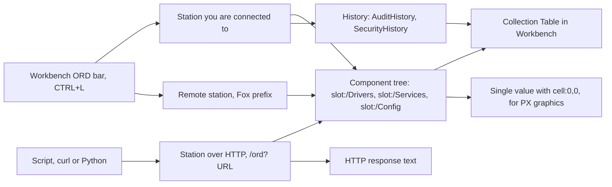
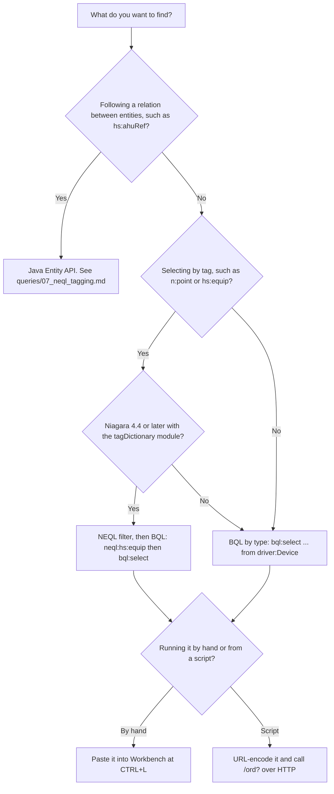

# Niagara 4 BQL and NEQL query examples: asset inventory and security reference

Copy-and-paste BQL and NEQL queries for building automation and OT engineers who need to inventory and check a Niagara 4 station.

The queries cover device inventory, point inventory, network topology, users and audit history, live status, and per-protocol detail for BACnet, Modbus, LonWorks, SNMP, KNX, OPC and Fox. They were written for Tridium Niagara 4 and JENEsys ProBuilder. Alarm database records and trend history are out of scope.

## Contents

- [Where to run them](#where-to-run-them)
- [Which query language do I use](#which-query-language-do-i-use)
- [Quick reference](#quick-reference)
- [Niagara 4 BQL cheat sheet](#niagara-4-bql-cheat-sheet)
- [BQL query examples](#bql-query-examples)
- [NEQL query examples](#neql-query-examples)
- [Device inventory](#device-inventory)
- [Status and alarm flags](#status-and-alarm-flags)
- [Security checks](#security-checks)
- [Running queries over HTTP](#running-queries-over-http)
- [JENEsys ProBuilder notes](#jenesys-probuilder-notes)
- [FAQ](#faq)
- [Sources](#sources)

## Where to run them

1. Open Workbench.
2. Press `CTRL+L` to open the ORD query bar.
3. Paste a query from this repo.
4. Replace `[stationName]` with your station name. Replace any `[cutoffDate]`, `[startDate]` or `[endDate]` with a date in `YYYY-MM-DD` form.
5. Press Enter. The results open in a Collection Table.

For a remote station, prefix the query with:

```
local:|fox:|station:|
```

The diagram shows the three ways a query in this repo reaches a station and what comes back.



## Which query language do I use

BQL selects components by type, for example `from driver:Device`. NEQL filters by tag first and then hands the filtered set to BQL. Relations between entities cannot be queried from `CTRL+L`. They need the Java Entity API.



## Quick reference

| Task | Language | Where to find it |
|------|----------|------------------|
| List every device on the station | BQL | [Universal device discovery](queries/01_device_inventory.md#1-universal-device-discovery) |
| Find devices that are down or faulted | BQL | [Device status snapshot](queries/01_device_inventory.md#2-device-status-snapshot) |
| See when each device last communicated | BQL | [Last communication time](queries/05_realtime_status.md#4-last-communication-time) |
| List control points, I/O and virtual points | BQL | [queries/02_point_inventory.md](queries/02_point_inventory.md) |
| Find stale, overridden or null points | BQL | [Point-level status](queries/05_realtime_status.md#2-point-level-status) |
| Map driver networks and Fox connections | BQL | [queries/03_network_topology.md](queries/03_network_topology.md) |
| List users and roles | BQL | [User enumeration](queries/04_security_access.md#1-user-enumeration) |
| Read the audit log and login events | BQL | [queries/04_security_access.md](queries/04_security_access.md) |
| List BACnet devices with address and device ID | BQL | [BACnet](queries/06_protocol_specific.md#bacnet) |
| List Modbus TCP and RTU devices | BQL | [Modbus](queries/06_protocol_specific.md#modbus) |
| Find assets by Niagara or Haystack tag | NEQL, then BQL | [queries/07_neql_tagging.md](queries/07_neql_tagging.md) |
| Follow a relation between entities | Java Entity API | [Relation queries](docs/NEQL_Reference.md#relation-queries) |
| Query a remote station | BQL with the Fox prefix | [Remote station](queries/01_device_inventory.md#5-remote-station-fox-protocol) |
| Run a query from a script | BQL or NEQL over HTTP | [queries/08_http_api.md](queries/08_http_api.md) |
| Look up select, where and time syntax | BQL | [docs/BQL_Syntax.md](docs/BQL_Syntax.md) |
| Find the type name for a `from` clause | BQL | [docs/Type_Hierarchy.md](docs/Type_Hierarchy.md) |
| Encode colons, spaces and dashes in slot names | BQL | [docs/Encoding.md](docs/Encoding.md) |

## Niagara 4 BQL cheat sheet

Eight discovery queries to start with, one line each.

```
-- ALL devices, all protocols
station:|slot:/Drivers|bql:select * from driver:Device

-- ALL control points, station-wide
station:|slot:/|bql:select slotPath, displayName, out, status from control:ControlPoint

-- ALL BACnet devices with address
station:|slot:/Drivers|bql:select name, address, deviceId, status from bacnet:BacnetDevice

-- ALL Modbus devices (TCP + RTU/Async)
station:|slot:/Drivers|bql:select * from modbusCore:ModbusClientDevice

-- Devices currently DOWN or FAULTED
station:|slot:/Drivers|bql:select slotPath, displayName, status from driver:Device where status.fault = true or status.down = true

-- Count all devices per driver network
station:|slot:/Drivers|bql:select parent.displayName as 'Network', count(name) as 'DeviceCount' from driver:Device

-- All users configured on station
station:|slot:/Services/UserService|bql:select * from user:User

-- NEQL: all tagged n:point assets
station:|slot:|neql:n:point|bql:select displayName, slotPath, ord
```

## BQL query examples

BQL (Baja Query Language) is the SQL-like query language built into Niagara 4. A query is a scope ORD, then a `bql:select` statement, then an optional output modifier such as `|cell:0,0`.

| File | What it covers |
|------|----------------|
| [queries/01_device_inventory.md](queries/01_device_inventory.md) | Every device across every protocol |
| [queries/02_point_inventory.md](queries/02_point_inventory.md) | Control points, I/O and virtual points |
| [queries/03_network_topology.md](queries/03_network_topology.md) | Driver networks, Fox connections between stations, services |
| [queries/04_security_access.md](queries/04_security_access.md) | Users, roles, permissions, audit trail |
| [queries/05_realtime_status.md](queries/05_realtime_status.md) | Device health: fault, down, stale, last communication |
| [queries/06_protocol_specific.md](queries/06_protocol_specific.md) | BACnet, Modbus, LonWorks, SNMP, KNX, OPC and Fox |
| [docs/BQL_Syntax.md](docs/BQL_Syntax.md) | BQL syntax: select, from, where, order by, time constants |
| [docs/Type_Hierarchy.md](docs/Type_Hierarchy.md) | Niagara type names for `from` clauses |
| [docs/Encoding.md](docs/Encoding.md) | ORD encoding rules for colons, spaces and special characters |

BQL does not support UNION. To list devices from several protocols at once, query the shared parent type `driver:Device`, or tag the devices and use NEQL.

## NEQL query examples

NEQL (Niagara Entity Query Language) filters by tag. It sits between the scope ORD and the BQL clause, so the tag filter runs before BQL does. It requires Niagara 4.4 or later and the `tagDictionary` module.

```
station:|slot:|neql:hs:equip|bql:select displayName, slotPath
```

| File | What it covers |
|------|----------------|
| [queries/07_neql_tagging.md](queries/07_neql_tagging.md) | Queries for Niagara (`n:`), Project Haystack (`hs:`) and custom tags |
| [docs/NEQL_Reference.md](docs/NEQL_Reference.md) | NEQL syntax, tag dictionaries, relations and the Java Entity API |

## Device inventory

This is the Niagara asset inventory query to start with. It returns every device under `Drivers`, whatever the protocol:

```
station:|slot:/Drivers|bql:select * from driver:Device
```

[queries/01_device_inventory.md](queries/01_device_inventory.md) adds named columns, device counts per network, disabled devices and last OK time. [queries/06_protocol_specific.md](queries/06_protocol_specific.md) has the per-protocol versions with fields such as BACnet device ID, Modbus unit ID and LonWorks Neuron ID.

If a query returns nothing, the type in the `from` clause may not match the device. [docs/Type_Hierarchy.md](docs/Type_Hierarchy.md) explains how to find the right one.

## Status and alarm flags

To select devices by status, filter on the status flags:

```
station:|slot:/Drivers|bql:select slotPath, displayName, status from driver:Device where status.fault = true or status.down = true
```

[queries/05_realtime_status.md](queries/05_realtime_status.md) has the rest: counts of down, faulted and healthy devices, points filtered by the fault, down, stale, disabled, alarm and overridden flags, faulted networks, and devices not heard from since a cutoff date.

These queries read the status flags on devices and points. They do not read the alarm database or trend history.

## Security checks

[queries/04_security_access.md](queries/04_security_access.md) lists users and roles, reads the audit history (logins, logouts, overrides and config changes), and finds certificate, TLS, web and Fox service components.

```
station:|slot:/Services/UserService|bql:select name as 'Username', displayName as 'Display Name', enabled as 'Enabled', roles as 'Roles' from user:User
```

The audit queries use `history:/[stationName]/AuditHistory`, so replace `[stationName]` before you run them.

## Running queries over HTTP

[queries/08_http_api.md](queries/08_http_api.md) shows the same kind of query as an `http://[ip]/ord?` URL for scripts and external tools, with Python and curl examples. This requires the Basic Hx Profile to be enabled on the JACE or supervisor. Spaces and some other characters must be URL-encoded. The table is in [docs/Encoding.md](docs/Encoding.md).

## JENEsys ProBuilder notes

- JENEsys controllers run Niagara N4, so all BQL and NEQL syntax is identical.
- The default station name is typically the controller hostname.
- Open the query bar from Workbench with `CTRL+L` or `File > Open > Open Query`.
- ProBuilder often uses the `lonworks:` driver. See [queries/06_protocol_specific.md](queries/06_protocol_specific.md).
- HTTP ORD queries require the Basic Hx Profile to be enabled on the JACE.

## FAQ

### What is the difference between BQL and NEQL?

BQL selects components by type and filters them with a `where` clause, much like SQL. NEQL filters entities by tag before BQL runs. In a query, NEQL goes between the scope ORD and the BQL clause. NEQL needs Niagara 4.4 or later and the `tagDictionary` module.

### Where do I paste a BQL query in Niagara Workbench?

Press `CTRL+L` in Workbench to open the ORD query bar, paste the query and press Enter. The results open in a Collection Table.

### Why does my BQL query return no results?

The type in the `from` clause may not match the device. Open the device's Slot Sheet in Workbench, read the Java class name and convert it: `BModbusTcpDevice` becomes `modbusTcp:ModbusTcpDevice`. The steps are in [docs/Type_Hierarchy.md](docs/Type_Hierarchy.md).

### Can one BQL query list devices from several protocols?

BQL has no UNION. Use the parent type `driver:Device`, which returns devices from all protocols, or add a custom marker tag to the devices and select them with NEQL.

### Can I query relations such as hs:equipRef from the query bar?

No. Relations have to be traversed in Java code with the Entity API. [docs/NEQL_Reference.md](docs/NEQL_Reference.md) has examples.

## Sources

- [Tridium official docs](https://docs.niagara-community.com)
- [mrupperman: Niagara Sample BQL Queries](https://gist.github.com/mrupperman/8a0761bbb416b8ef1ca4f51c228f63bf)
- [thomasjupe: NiagaraN4BQLQueries](https://github.com/thomasjupe/NiagaraN4BQLQueries)
- [iC Knowledge Base: Multi-Protocol BQL](https://icdocs.ismacontrolli.com/kb/article/niagara-network-protocols-bql-queries-for-device-i)
- [Tridium Summit: NEQL Tags and Relations PDF](https://pages1.tridium.com/rs/808-SGM-271/images/EntitiesTagsNEQL.pdf)

## More from CyberAutomations

Read the [project write-up for this reference](https://cyberautomations.com/work/niagara-bql-neql-reference?utm_source=github&utm_medium=readme&utm_campaign=niagara-bql-neql-reference), or draw your OT network with [OTDraw, a free OT network diagram tool](https://cyberautomations.com/tools/otdraw?utm_source=github&utm_medium=readme&utm_campaign=niagara-bql-neql-reference).


<!-- ca-tracked-link -->
[cyberautomations.com](https://cyberautomations.com/?utm_source=github&utm_medium=readme&utm_campaign=niagara-bql-neql-reference)
